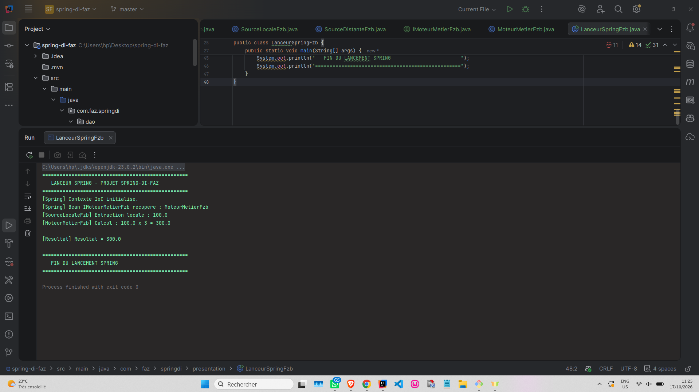
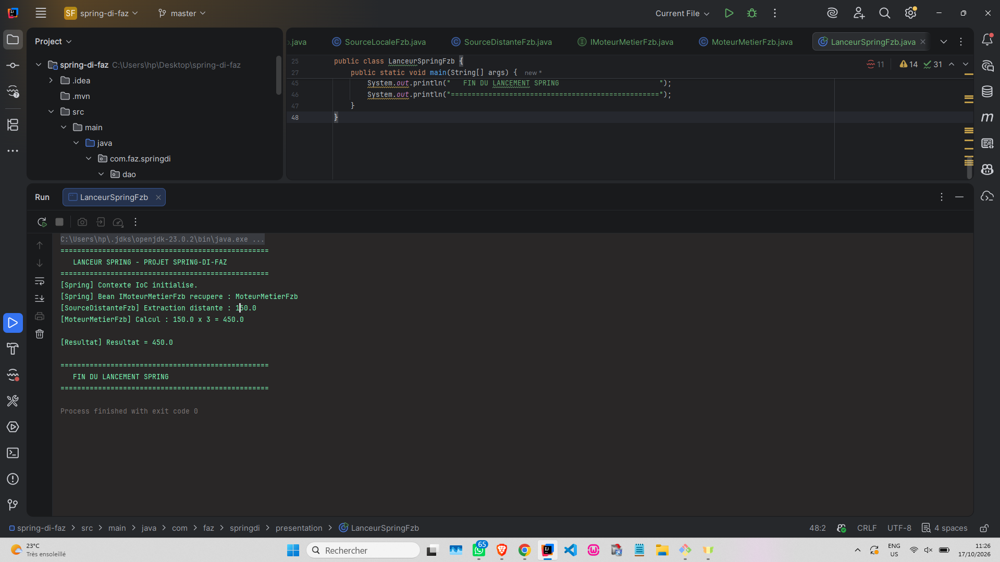
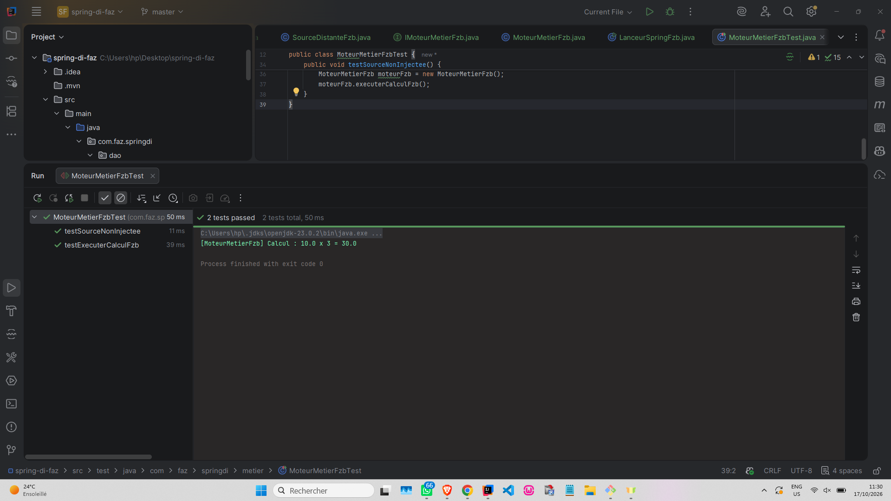

# Spring DI Faz - Injection de Dépendances

Projet Java Spring démontrant l'inversion de contrôle (IoC) et l'injection de dépendances (DI) via annotations et configuration XML.

## 📸 Captures d'écran

### Simulation 1 : Source Locale
*Configuration Spring utilisant l'implémentation `SourceLocaleFzb` avec un calcul de `100.0 x 3 = 300.0`.*

### Simulation 2 : Source Distante
*Configuration Spring utilisant l'implémentation `SourceDistanteFzb` avec un calcul de `150.0 x 3 = 450.0`.*

### Tests Unitaires JUnit
*Validation du moteur métier avec injection manuelle d'un mock et vérification des exceptions.*

